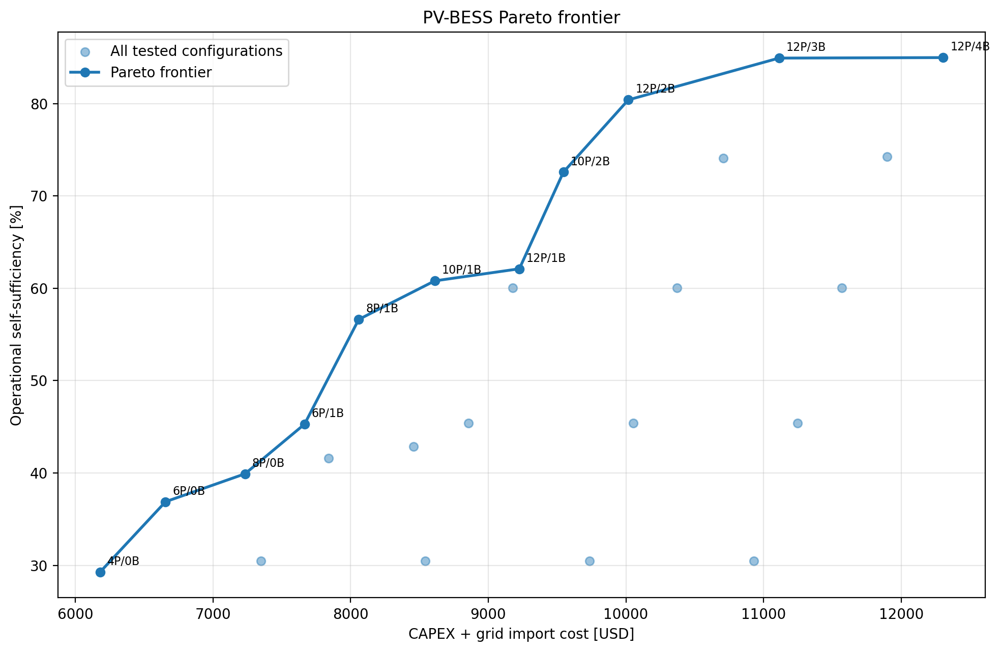
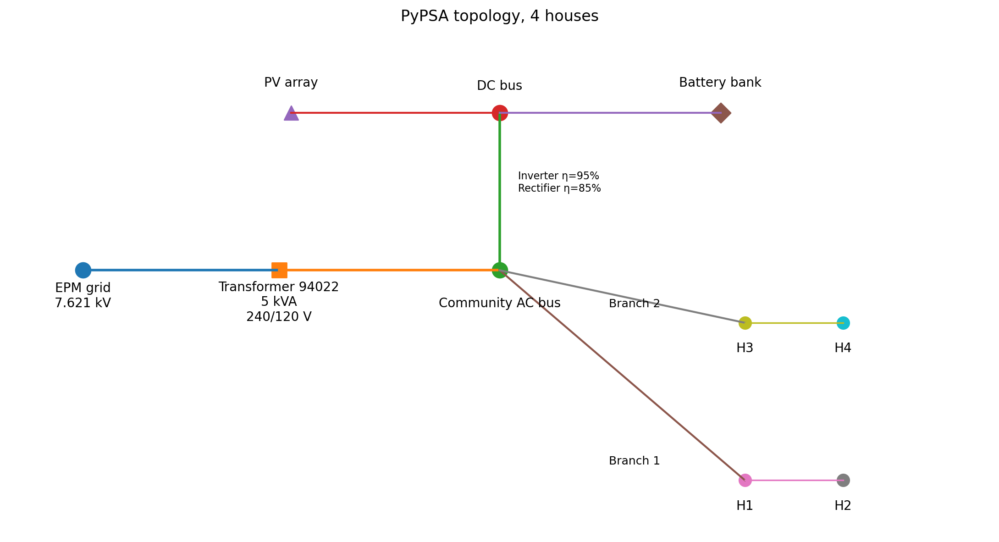
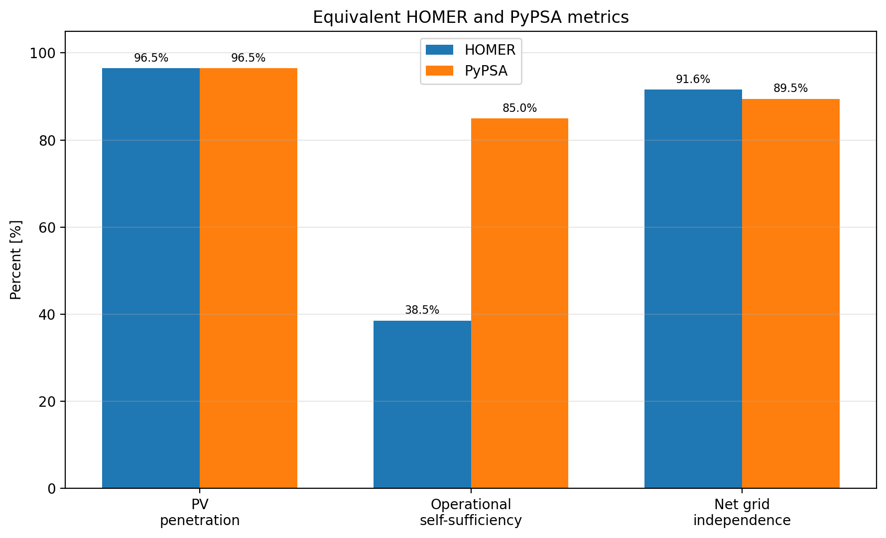
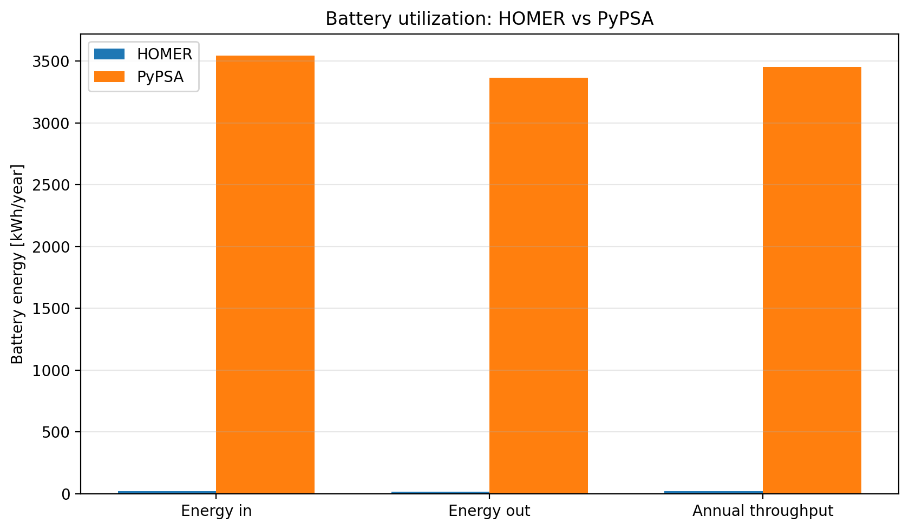
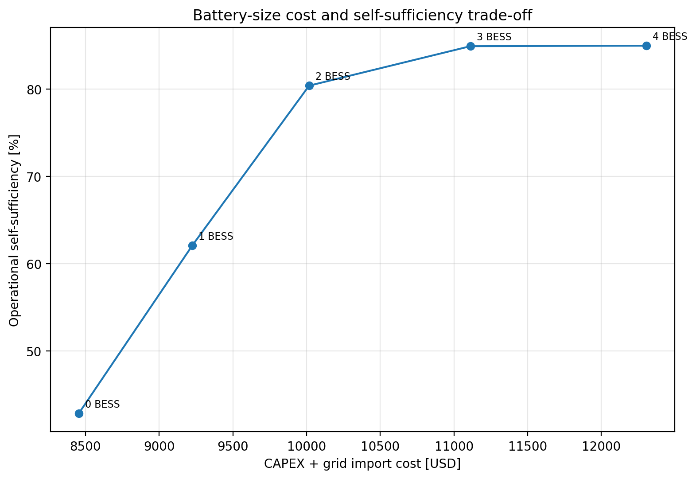
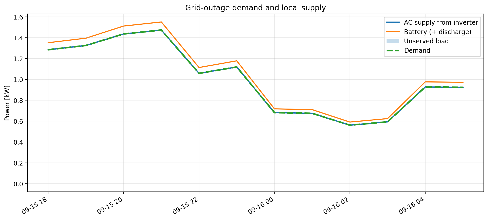

# San Rafael Energy Community: Open Energy Modelling and Grid-Impact Assessment

This repository contains an open and reproducible energy-modelling workflow for a rural **energy community near San Rafael / San Carlos, Antioquia, Colombia**.

The project evaluates how a shared **solar PV + battery energy storage system (BESS)** can reduce community dependence on the EPM electricity grid while maintaining reliable supply. It also prepares the operating data required for a subsequent **pandapower distribution-grid impact assessment**.

The work was developed in the context of the **SEEDexchange Open Energy Modelling Workshop 2026** in Medellín and San Rafael, Colombia.

The modelling workflow combines:

- **HOMER** as the reference techno-economic system and source of accepted component parameters
- **PyPSA** for hourly community energy balancing, self-sufficiency, storage dispatch, design sweeps and outage studies
- **pandapower** for the subsequent detailed LV/MV network analysis
- **NASA POWER** and project-specific demand/resource data
- **EPM distribution-grid information** for the San Rafael / San Carlos network context

---

## 🎯 Project Objective

The central question is:

> **How far can the community reduce its dependence on the electricity grid using local PV and battery storage, and what does that operating strategy imply for the distribution network?**

The project therefore considers two connected perspectives:

### Community perspective

The community wants to:

- use locally generated solar energy first
- store excess PV in batteries
- reduce grid imports
- improve energy resilience
- understand the cost and hardware requirements of higher self-sufficiency

### Grid-operator perspective

The network study investigates:

- residual grid imports
- PV exports and reverse power flow
- transformer loading
- LV voltage behaviour
- conductor loading
- critical operating conditions at the point of common coupling

The workflow is intentionally split between **PyPSA** and **pandapower** because the two tools answer different questions.

```text
HOMER / quotation / resource data
              |
              v
       demand + PV profiles
              |
              v
            PyPSA
   hourly community dispatch
              |
      +-------+-------+
      |               |
      v               v
 annual KPIs      outage study
      |
      v
hourly PCC / PV / load / BESS handoff
              |
              v
          pandapower
 detailed electrical-network analysis
```

---

## 🚀 Main Features

✅ **8,760-hour annual PyPSA simulation**

✅ **Local-first dispatch strategy**
- PV serves demand first
- surplus PV charges the battery
- battery discharges before grid import
- grid is used only for the residual deficit
- export occurs only after local load and storage needs are satisfied

✅ **No normal-operation grid charging of the battery**

✅ **Reference-system comparison against HOMER**

✅ **Separate reporting of**
- PV penetration
- operational self-sufficiency
- net grid independence
- grid-independent hours
- gross grid imports and exports

✅ **PV sizing sweep**

✅ **Battery sizing sweep**

✅ **25-configuration PV/BESS design search**

✅ **Pareto analysis using**
`CAPEX + annual gross grid-import cost`

✅ **Grid-outage and resilience analysis**

✅ **Battery-cycling comparison between HOMER and PyPSA**

✅ **Automatic export of hourly PyPSA results for pandapower**

✅ **Reproducible CSV outputs and figures**

---

## ⚡ Reference Energy System

The main reference case represents **four households** connected behind the local EPM distribution transformer.

| Parameter | Reference value |
|---|---:|
| Households | 4 |
| Annual demand | 7,592 kWh/year |
| PV modules | 12 × 435 W |
| PV capacity | 5.22 kWp DC |
| Annual PV production | 7,326.3 kWh/year |
| Inverter | 5 kW |
| Battery modules | 4 |
| HOMER-modelled battery bank | 19.2 kWh nominal |
| Usable battery energy | 17.3 kWh |
| Battery round-trip efficiency | 95% |
| Local transformer | 5 kVA |
| MV voltage | 7.621 kV |
| LV voltage | 240/120 V |
| Grid purchase tariff | 0.290 USD/kWh |
| Grid export tariff | 0.275 USD/kWh |
| Quotation subtotal | 11,974.79 USD |
| Quotation total including VAT | 14,250.00 USD |

> **Battery note:** the quotation identifies four Deye 5.12 kWh modules, while the final HOMER model represents the bank as 19.2 kWh nominal and 17.3 kWh usable. PyPSA follows the HOMER-modelled capacity for consistency with the reference simulation.

---

## 🧠 Dispatch Philosophy

The PyPSA model is **not tariff-driven**.

Its purpose is to maximize practical local use of renewable energy and reduce reliance on EPM.

The dispatch hierarchy is:

```text
PV
 |
 +--> community demand
 |
 +--> battery charging
 |
 +--> residual export

When PV is insufficient:

battery
 |
 +--> community demand
 |
 +--> residual deficit supplied by EPM
```

A large internal grid-import penalty is used only to enforce this dispatch priority.

It is **not an electricity tariff** and is not used for economic reporting.

---

## 📊 Main Performance Metrics

### PV penetration

```text
PV penetration = annual PV generation / annual load
```

The reference system has approximately **96.5% PV penetration**.

This does **not** mean 96.5% self-sufficiency.

---

### Operational self-sufficiency

```text
Self-sufficiency
= 1 - gross grid imports / annual load
```

This measures the share of community demand that does not require grid imports.

For the final PyPSA reference case:

- **Operational self-sufficiency: ~85.38%**
- **Grid imports: ~1,109.85 kWh/year**

---

### Net grid independence

```text
Net grid independence
= 1 - (grid imports - grid exports) / annual load
```

This credits exported energy against imports.

For the final PyPSA reference case:

- **Net grid independence: ~89.45%**
- **Grid exports: ~308.71 kWh/year**

Operational self-sufficiency and net grid independence are reported separately because they answer different questions.

---

## 🔋 HOMER vs PyPSA

The final HOMER system and the PyPSA reference use the same annual PV-energy reference, but their battery operation is very different.

| Metric | HOMER | PyPSA |
|---|---:|---:|
| PV penetration | 96.50% | 96.50% |
| Operational self-sufficiency | 38.52% derived | 85.38% |
| Net grid independence | 91.62% derived | 89.45% |
| Grid imports | 4,667.4 kWh/year | 1,109.85 kWh/year |
| Grid exports | 4,030.9 kWh/year | 308.71 kWh/year |
| Battery throughput | 17.745 kWh/year | ~3,471 kWh/year |

The key difference is storage utilization.

HOMER barely cycles the battery, while the PyPSA local-first strategy actively stores daytime PV for later demand. This strongly reduces **gross physical dependence on the grid**.

---

## 🔍 Design Studies

### PV sweep

The practical PV design space is limited to:

```text
4, 6, 8, 10, 12 panels
```

**12 panels is the maximum allowed configuration.**

No 14-panel case is included.

---

### Battery sweep

The reference 12-panel PV system is tested with:

```text
0, 1, 2, 3, 4 battery modules
```

A key result is that the annual self-sufficiency benefit saturates strongly between three and four batteries.

| BESS modules | Self-sufficiency | Grid import |
|---:|---:|---:|
| 0 | 43.06% | 4,323.12 kWh |
| 1 | 62.31% | 2,861.40 kWh |
| 2 | 81.04% | 1,439.69 kWh |
| 3 | 85.33% | 1,113.85 kWh |
| 4 | 85.38% | 1,109.85 kWh |

The fourth battery provides very little additional annual self-sufficiency, although it may still provide additional resilience margin.

---

### Self-sufficiency design search

The model evaluates:

```text
5 PV sizes × 5 BESS sizes = 25 configurations
```

PV sizes:

```text
4, 6, 8, 10, 12 panels
```

Battery sizes:

```text
0, 1, 2, 3, 4 modules
```

The selected design steps currently include:

| Configuration | Operational self-sufficiency |
|---|---:|
| 8P / 1B | 57.20% |
| 10P / 1B | 61.00% |
| 10P / 2B | 72.74% |
| 12P / 2B | 81.04% |

Within the current practical hardware bounds, **90%, 95% and 100% operational self-sufficiency are not reached**.

---

## 💰 Screening Cost

For design comparison, the project uses the explicitly defined screening metric:

```text
Screening cost
= installed CAPEX
+ one year of gross grid-import cost
```

The Pareto x-axis therefore reads:

```text
CAPEX + grid import cost [USD]
```

Export revenue is shown separately and is **not subtracted** from this screening cost.

This is a **screening indicator**, not a lifecycle NPC or LCOE.

---

## 📈 Pareto Frontier

The Pareto analysis compares:

- **x-axis:** CAPEX + grid import cost [USD]
- **y-axis:** operational self-sufficiency [%]

All 25 practical PV/BESS configurations are plotted.

The Pareto frontier connects only **non-dominated configurations**, meaning no other tested design has both:

- lower or equal screening cost, and
- equal or higher self-sufficiency

with at least one strict improvement.



---

## 🛡️ Outage and Resilience Study

The outage model disconnects the community from EPM while allowing PV and stored battery energy to continue supplying demand.

Reference outage assumptions:

- initial battery SOC: **80%**
- outage starts at **18:00**
- grid import/export unavailable
- PV remains available
- load shedding is explicitly measured

Current outage-duration results:

| Outage duration | Load served |
|---:|---:|
| 4 h | 100% |
| 8 h | 100% |
| 12 h | 100% |
| 24 h | 99.25% |

For the 24-hour outage, only about **0.177 kWh** is unserved.

This indicates strong short-duration resilience but does not imply indefinite island operation.

---

## 🌐 PyPSA to pandapower Handoff

PyPSA exports the hourly operating state of the reference system for detailed network analysis.

The main handoff file is:

```text
pandapower_handoff_S2_REFERENCE_PV_BESS.csv
```

It contains:

- timestamp
- PCC import/export
- PV DC production
- inverter AC output
- community load
- battery DC power
- battery state of charge

Additional files define:

- local transformer and circuit metadata
- critical operating timestamps
- LV branch assignment

The pandapower stage will use these data to study:

- transformer loading
- reverse power flow
- LV voltage rise/drop
- conductor loading
- critical grid-import and PV-export conditions

---

## 📥 Main Inputs

### Energy-system reference

- `SimulacionTampico1k(1).xml`
- `System Report - SimulacionTampico1k.hmr(1).html`

### Solar resource

- `Nasa Data(2).csv`

### Reference quotation

- `Proposal - Hackaton Medellin(1).pdf`

### Demand / supporting datasets

- `BaseTotalDemand_SR.CSV`
- `Demand_curve.xlsx`
- `Curva_típica_Regional_Antioquia.xlsx`
- `SanRafael_4HH_Monthly_Hourly_Load_Profiles.xlsx`

### Grid and spatial data

- `SanRafael_Grid_Data_Pack_v2.xlsx`
- `SanRafael_Grid_Data_v2.csv`
- `Coordinates San Rafael`
- `Foto satelital con viviendas en la Cuenca del Arenal.jpg`
- EPM route/trace figures

---

## 📤 Main Outputs

The PyPSA notebook writes numerical outputs to:

```text
results/
```

Important files include:

- `core_cases.csv`
- `pv_panel_sweep.csv`
- `bess_module_sweep.csv`
- `self_sufficiency_candidates.csv`
- `self_sufficiency_design_steps.csv`
- `self_sufficiency_infeasible_targets.csv`
- `homer_reference_context.csv`
- `homer_pypsa_metric_alignment.csv`
- `homer_pypsa_reference_energy_flows.csv`
- `outage_reference_case.csv`
- `outage_reference_dispatch.csv`
- `outage_duration_sweep.csv`
- `pandapower_handoff_S2_REFERENCE_PV_BESS.csv`
- `pandapower_metadata_S2_REFERENCE_PV_BESS.csv`
- `lv_branches_S2_REFERENCE_PV_BESS.csv`

Figures are written to:

```text
results/figures/
```

---

## 🖼️ Important Figures

### PyPSA topology



### HOMER vs PyPSA metrics



### Battery utilization



### Battery-size trade-off



### Outage dispatch



---

## 🧑‍💻 How to Run the PyPSA Model

### 1. Clone the repository

```bash
git clone <repository-url>
cd energy-community
```

### 2. Create or activate a Python environment

Using conda:

```bash
conda create -n sanrafael python=3.12
conda activate sanrafael
```

### 3. Install requirements

```bash
pip install -r SanRafael_PyPSA_requirements.txt
```

The main dependencies are:

```text
pypsa
highspy
pandas
numpy
matplotlib
```

### 4. Start Jupyter

```bash
jupyter lab
```

or:

```bash
jupyter notebook
```

### 5. Open the final PyPSA notebook

```text
SanRafael_PyPSA_Scenarios_v16.ipynb
```

### 6. Run all cells from top to bottom

The notebook will:

1. locate the input data
2. reconstruct the annual load series
3. reconstruct and calibrate the hourly PV profile
4. build the PyPSA network
5. solve the core cases
6. run PV and BESS sweeps
7. run the self-sufficiency design search
8. calculate the Pareto frontier
9. run outage scenarios
10. generate result CSVs and figures
11. export the pandapower handoff

---

## ⚙️ Technical Stack

- **Python**
- **PyPSA** — energy-system modelling and linear optimization
- **HiGHS** — optimization solver
- **pandas** — data handling
- **NumPy** — numerical processing
- **Matplotlib** — plotting
- **pandapower** — detailed electrical-network stage
- **HOMER** — reference system / benchmark
- **NASA POWER** — solar-resource input
- **Jupyter Notebook** — reproducible modelling workflow

---

## 📁 Recommended Repository Structure

```text
energy-community/
│
├── README.md
├── SanRafael_PyPSA_Model_Documentation.md
├── SanRafael_PyPSA_Scenarios_v16.ipynb
├── SanRafael_PyPSA_requirements.txt
│
├── data/
│   ├── SimulacionTampico1k(1).xml
│   ├── System Report - SimulacionTampico1k.hmr(1).html
│   ├── Nasa Data(2).csv
│   ├── BaseTotalDemand_SR.CSV
│   ├── Demand_curve.xlsx
│   ├── Curva_típica_Regional_Antioquia.xlsx
│   ├── SanRafael_4HH_Monthly_Hourly_Load_Profiles.xlsx
│   ├── SanRafael_Grid_Data_Pack_v2.xlsx
│   ├── SanRafael_Grid_Data_v2.csv
│   ├── Coordinates San Rafael
│   └── Proposal - Hackaton Medellin(1).pdf
│
├── spatial/
│   ├── Foto satelital con viviendas en la Cuenca del Arenal.jpg
│   ├── epm_primary_boundary_trace_94022.png
│   └── epm_secondary_trace_94022_corrected.png
│
├── results/
│   ├── core_cases.csv
│   ├── pv_panel_sweep.csv
│   ├── bess_module_sweep.csv
│   ├── self_sufficiency_candidates.csv
│   ├── self_sufficiency_design_steps.csv
│   ├── self_sufficiency_infeasible_targets.csv
│   ├── homer_reference_context.csv
│   ├── homer_pypsa_metric_alignment.csv
│   ├── homer_pypsa_reference_energy_flows.csv
│   ├── outage_reference_case.csv
│   ├── outage_reference_dispatch.csv
│   ├── outage_duration_sweep.csv
│   ├── pandapower_handoff_S2_REFERENCE_PV_BESS.csv
│   ├── pandapower_metadata_S2_REFERENCE_PV_BESS.csv
│   ├── lv_branches_S2_REFERENCE_PV_BESS.csv
│   │
│   └── figures/
│       ├── pypsa_topology_4hh.png
│       ├── homer_pypsa_metric_alignment.png
│       ├── homer_pypsa_battery_cycling.png
│       ├── self_sufficiency_pareto_frontier.png
│       ├── bess_sweep_capex_plus_grid_cost_vs_self_sufficiency.png
│       ├── outage_dispatch.png
│       └── ...
│
└── docs/
    └── supporting workshop/project documentation
```

This structure is recommended for the cleaned repository. If the current local folder already uses a different organization, the README paths should be changed to match the final committed structure.

---

## 📖 Detailed Technical Documentation

For a complete explanation of:

- notebook sections
- modelling assumptions
- KPI equations
- HOMER/PyPSA comparison
- every generated plot
- every output CSV
- pandapower handoff
- current numerical results
- model limitations

see:

[**SanRafael_PyPSA_Model_Documentation.md**](SanRafael_PyPSA_Model_Documentation.md)

---

## ⚠️ Main Model Limitations

### Synthetic hourly PV profile

The available solar-resource input is monthly rather than measured hourly irradiance.

The hourly PV profile is therefore reconstructed using solar geometry and calibrated to the accepted HOMER annual PV production.

Annual energy is well anchored, but exact hourly solar timing is approximate.

### Household load diversity

The four-house reference uses HOMER-derived normalized load profiles.

Additional houses in the household-count sweep use the same underlying profile shape.

The current model therefore does not represent measured household-to-household diversity.

### Aggregated PyPSA network

PyPSA models the community at an aggregated AC/DC energy-system level.

Detailed:

- LV voltage
- conductor current
- transformer impedance
- phase imbalance
- voltage drop/rise

are outside the PyPSA model and belong to pandapower.

### Alternative configuration costs

Only the reference 12-panel / 4-battery system has an actual quotation.

Costs for other configurations are screening extrapolations.

### Screening cost

`CAPEX + one year of grid import cost` is a project-specific screening metric.

It must not be interpreted as:

- Net Present Cost
- Levelized Cost of Electricity
- annualized lifecycle cost

---

## 🔜 Current Project Status

### PyPSA stage

**Completed for the current study scope.**

The model now includes:

- reference annual operation
- HOMER comparison
- household sweep
- PV sweep
- BESS sweep
- design search
- Pareto frontier
- outage analysis
- pandapower handoff
- reproducible output files
- detailed technical documentation

### Next stage

The remaining technical work is primarily the **pandapower network-impact analysis**, including:

- transformer loading
- reverse power flow
- LV voltage behaviour
- conductor loading
- critical operating snapshots
- combined community + grid conclusions

---

## 📚 Data and Software References

- [PyPSA](https://pypsa.org/) — open energy-system modelling framework
- [pandapower](https://www.pandapower.org/) — power-system analysis in Python
- [HiGHS](https://highs.dev/) — open-source optimization solver
- [NASA POWER](https://power.larc.nasa.gov/) — solar and meteorological resource data
- [SEEDexchange](https://uol.de/) — project and institutional context through the University of Oldenburg and partner institutions

Project-specific HOMER, quotation, EPM and community datasets are stored in the repository where redistribution is permitted.

---

## ✍️ Acknowledgements

Developed as part of the **SEEDexchange / Open Energy Modelling** activities and the 2026 workshop in Medellín and San Rafael, Colombia.

Partner institutions and organizations include:

- **University of Oldenburg (UOL), Germany**
- **University of Energy and Natural Resources (UENR), Ghana**
- **Universidad de Antioquia (UdeA), Colombia**
- **Solunagua / CTWC, San Rafael, Colombia**

The San Rafael community case and local partner input provide the real-world context for the modelling exercise.

---

## 📌 Citation / Reuse

If this repository is reused for another case study, please clearly distinguish:

- project-specific measured or supplied data
- HOMER-derived reference values
- reconstructed/synthetic time series
- engineering assumptions
- screening cost assumptions

The goal of the repository is not only to reproduce the results, but also to make the **assumptions and limitations transparent**.
